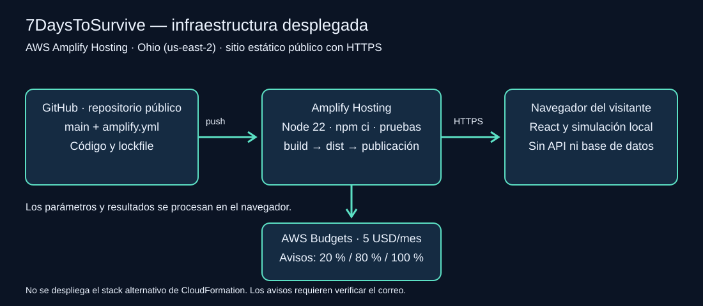
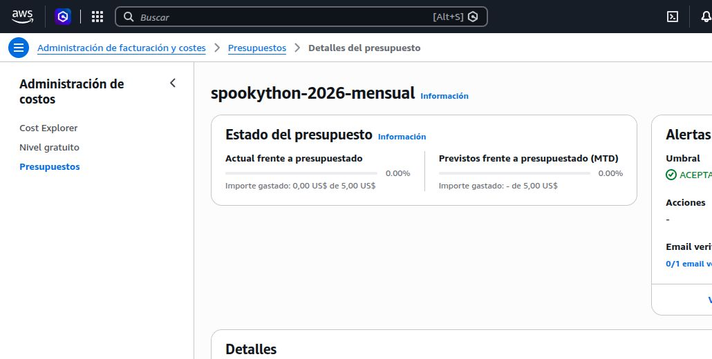
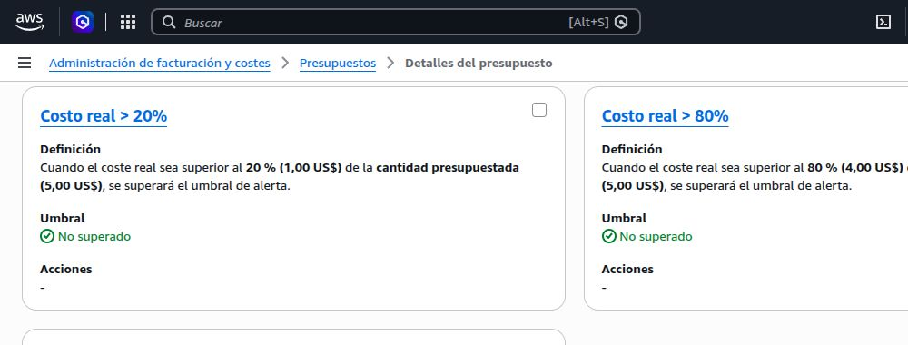

# MantaZero

Herramienta de apoyo a decisiones que simula la propagación de un brote y compara una estrategia de vacunación con dos líneas base: no intervenir e intervenir tarde con menos recursos.

## Estado del proyecto

- Modelo SIR determinista ejecutado día a día.
- Interfaz interactiva para modificar población, contagio, vacunas e inicio de la intervención.
- Comparación cuantitativa de escenarios y recomendación en lenguaje simple.
- Pruebas de reproducibilidad, conservación de población y comparación de estrategias.
- Despliegue estático en AWS Amplify Hosting; configuración de build versionada.

## Ejecución local

Requisitos: Node.js 22 y npm.

```bash
npm install
npm run dev
```

Validación completa:

```bash
npm test
npm run build
```

## Despliegue en AWS

Demo pública: **https://main.d3kt9g5gofzhxh.amplifyapp.com/**

AWS Amplify Hosting, región **Ohio (`us-east-2`)**, rama **`main`**.
El archivo [amplify.yml](amplify.yml) instala Node 22 y dependencias con `npm ci`, ejecuta `npm test` y `npm run build`, y publica `dist`.
La aplicación actual no requiere variables de entorno, claves AWS, API ni base de datos.

[Diagrama de arquitectura SVG](docs/arquitectura.svg) · [Operación del equipo](docs/infraestructura.md) · [Costos](docs/costos.md)



AWS Budget `spookython-2026-mensual` creado con 5 USD/mes y alertas reales a 1, 4 y 5 USD. Las capturas recortadas documentan el presupuesto y sus umbrales sin exponer datos personales. **El correo seguía pendiente de verificación el 30/10/2026**; debe verificarse para recibir los avisos. El Budget avisa, pero no detiene servicios ni constituye un límite duro de gasto.





El stack S3/CloudFront y el script PowerShell del repositorio son una alternativa histórica; no se utilizan para este despliegue de Amplify.

## Supuestos del modelo

- Población cerrada durante el horizonte simulado.
- Mezcla homogénea: cada persona tiene la misma probabilidad de contacto.
- Las personas vacunadas dejan de ser susceptibles el mismo día.
- La intervención también reduce 18 % la transmisión para representar comunicación y medidas preventivas.
- No se modelan nacimientos, fallecimientos, reinfección ni pérdida de inmunidad en esta fase.

Los números son parámetros de simulación, no predicciones clínicas. Deben calibrarse con fuentes epidemiológicas antes de tomar decisiones reales.

## Estructura

```text
src/
  components/       interfaz reutilizable
  domain/           modelo y pruebas
docs/               arquitectura, costos y supuestos
infra/              infraestructura AWS
scripts/            automatización operativa
.github/workflows/  integración continua
```

## Documentación

- [Arquitectura](docs/arquitectura.md)
- [Estimación de costos](docs/costos.md)
- [Plan de implementación para la prueba de fuego](docs/plan-ganar.md)

## Equipo

Proyecto desarrollado para SpookyThon 2026 · Track B: La Plaga Zombie.

## Licencia

MIT
