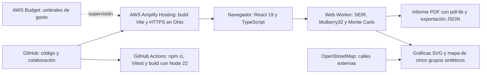

# Pitch final — 7DaysToSurvive

[PDF para presentar](pitch-corto.pdf) · [PowerPoint editable](pitch-corto.pptx) · [Diagrama del proyecto](arquitectura-presentacion.png)

Seis diapositivas para cinco minutos, en blanco, rojo y verde. El PowerPoint incluye notas para el presentador y las fuentes de las cifras. El gráfico y el diagrama son editables.

| Tiempo | Diapositiva | Qué contar |
|---|---|---|
| 0:00–0:30 | Cada vacuna cuenta | Manta tiene recursos limitados y debemos decidir dónde actuar primero. |
| 0:30–1:05 | El problema | Escenario ficticio de 15.000 personas, 35 infecciosos en mercado y 180 dosis diarias. |
| 1:05–1:50 | La solución | Cambiar el escenario, probar 120 futuros y explicar una decisión reproducible. |
| 1:50–2:35 | Resultado | Con semilla 2026: 451,5 contagios evitados medios frente al azar y rango pareado P10–P90 de 326,6 a 595,6. No garantiza superioridad universal. |
| 2:35–4:00 | Brote Sorpresa y demo | Abrir la app, modo presentación y ×3. Mostrar el mapa y PDF. Después cambiar contagio o stock y explicar la nueva comparación. |
| 4:00–5:00 | Diagrama | GitHub/Actions/Vitest → AWS Amplify → navegador React/TypeScript. Worker SEIR/Monte Carlo; OSM y gráficas; PDF/JSON. Cerrar con el valor de decidir con evidencia. |

## Antes de entrar

- Abrir https://main.d3kt9g5gofzhxh.amplifyapp.com/ y restablecer el escenario oficial.
- Tener el PDF del pitch y el informe para el alcalde descargados.
- El jurado puede cambiar la semilla. Conservar pérdidas y empates.
- El mapa es ilustrativo de cinco grupos sintéticos; no localiza ciudadanos infectados en calles reales.
- El costo de las vacunas es ficticio. El costo mensual de AWS es una estimación documentada, no una factura garantizada.
- Confirmar el correo del Budget: la última evidencia seguía pendiente.

El informe para el alcalde complementa este pitch. La release v0.1.0 conserva su commit original; no se modificó el tag ni se cambió la entrega de la plataforma.

## Flujo técnico

